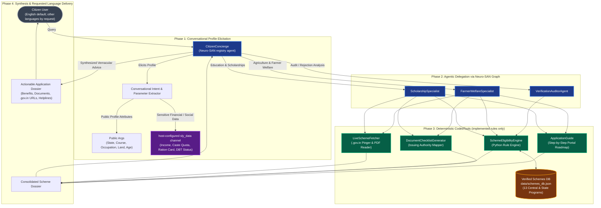
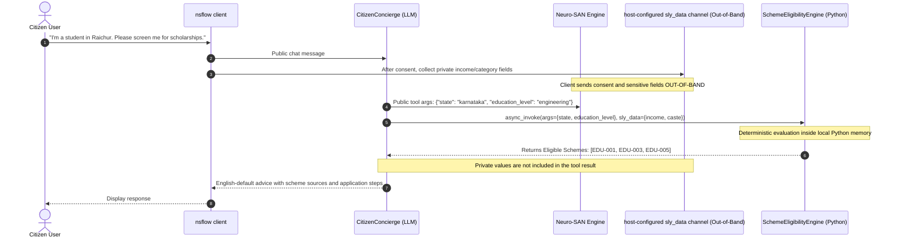
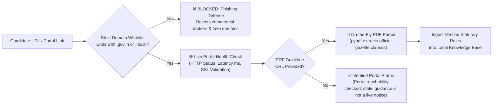
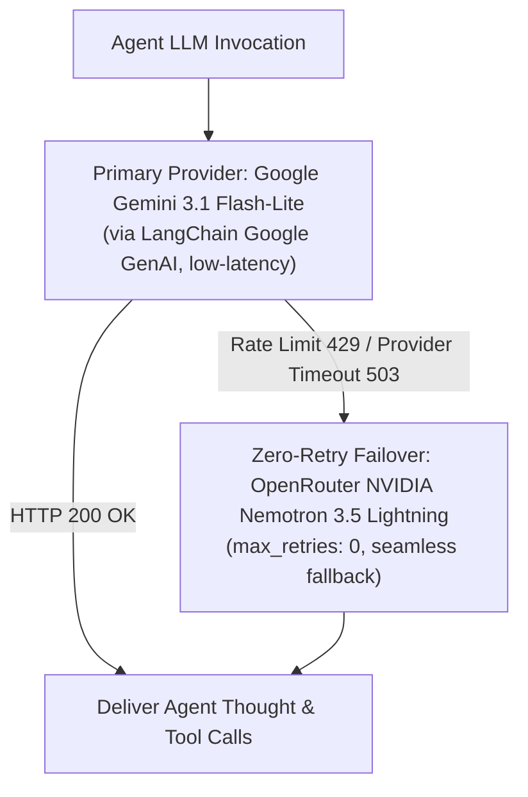
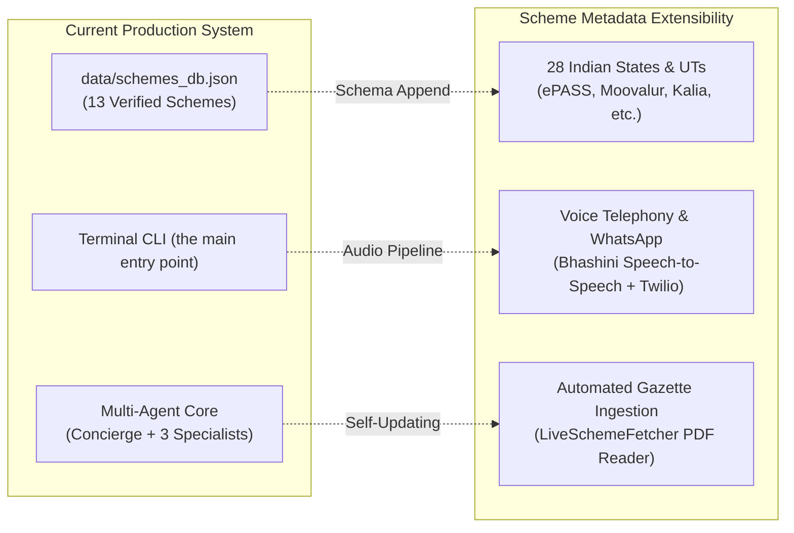

# 🧱 Scheme Navigator (YojanaMitra AI) — System Architecture

**Autonomous Multi-Agent Welfare & Scholarship Concierge for Indian Citizens**  
*Cognizant AI Lab × Indian Institute of Information Technology Raichur — Agentic AI Hackathon (October 2026)*

---

## 1. Executive Mission & What We Are Trying To Do

### 1.1 The Problem Statement
Every fiscal year, the Central and State Governments of India allocate over **₹3,00,000 Crore** across hundreds of citizen welfare, agricultural support, and higher education scholarship initiatives. Despite this massive public funding, **more than ₹1,00,000 Crore goes unclaimed or gets rejected annually**.

This crisis of delivery stems from four structural bottlenecks in the welfare delivery ecosystem:

1. **Information Asymmetry & Portal Fragmentation**:
   Welfare guidelines are dispersed across dozens of siloed national and state portals (*National Scholarship Portal (NSP)*, *Karnataka State Scholarship Portal (SSP)*, *Andhra Pradesh JnanaBhumi*, *PM-KISAN*, *PMFBY*). A rural engineering student in Raichur or an agrarian family in Anantapur rarely knows they qualify for complete tuition fee reimbursement or subsidized seasonal credit.
2. **Ambiguous Statutory Rules & Hallucination Risks**:
   Statutory rules contain complex, multi-variable constraints: Class 12 board percentile cutoffs, annual parental income ceilings, landholding acreage caps (small vs. marginal farmers), crop insurance deadlines, and exclusion clauses (e.g., income tax filing status). When citizens search online or ask general-purpose LLM chatbots, these chatbots regularly **hallucinate cutoff numbers, invent invalid deadlines, or misstate income limits**.
3. **Document Rejection at Verification**:
   Even when citizens discover schemes, up to **40% of applications are rejected** at institutional verification stages due to subtle procedural defects: missing 15-digit Nadakacheri RD numbers, expired MeeSeva income certificates, or bank accounts that are active but not mapped on the **NPCI Direct Benefit Transfer (DBT) gateway**.
4. **Predatory Middlemen & Brokerage Extortion**:
   Illiterate or semi-literate citizens are routinely exploited by unauthorized local brokers charging 20% to 30% commissions for welfare programs that are 100% free by law.

### 1.2 Our Solution & Mission
**Scheme Navigator (YojanaMitra AI)** provides a Neuro-SAN agent network and a separate local CLI demo. Run `python main.py --agent` to launch the focused agent network and `nsflow` UI; run `python main.py` for direct local tool calls. The network:

- Supports English by default and other configured languages when explicitly requested in the concierge prompt.
- Evaluates profiles against implemented Python rules. Deterministic execution avoids LLM-generated decisions for those rules, but does not guarantee that criteria are current or complete.
- Declares income, category, landholding, and taxpayer details in the front-man **`sly_data_schema`**, requires explicit consent in the eligibility tool, and rejects private fields passed in ordinary tool arguments. Runtime privacy still depends on the client and deployment configuration.
- Provides rule-by-rule screening explanations, surfaces missing information and unsupported rules, and suggests next actions.
- Checks reachability of configured official portals. Portal checks do not retrieve current announcements; optional fetch actions can parse PDF/HTML text from allowed HTTPS government domains.
- Equips citizens with application guidance: state issuing authorities (*Nadakacheri, MeeSeva, DigiLocker, UIDAI*), common documents, and anti-fraud reminders.

> **Implementation status:** The diagrams describe the Neuro-SAN flow launched with `python main.py --agent`. The default `python main.py` mode remains a local CLI that directly invokes coded tools.

---

## 2. End-to-End System Workflow

The end-to-end processing lifecycle flows through four distinct phases:



---

## 3. Highlighting the Agentic System Architecture

Scheme Navigator is designed from the ground up around **Cognizant's Neuro-SAN (Service-Agent-Network)** framework. Rather than treating an LLM as an all-in-one oracle, Scheme Navigator implements the **Front Man Multi-Agent Design Pattern**, separating empathetic conversational reasoning from strict statutory verification.

### 3.1 Multi-Agent Topology & Hierarchy

The agent collective is specified declaratively in HOCON (`registries/scheme_navigator.hocon`) and executed via the Neuro-SAN runtime:

```
                            ┌────────────────────────────────────────┐
                            │           Citizen User                 │
                            │  (English, Telugu, Hindi, Kannada, etc)│
                            └───────────────────┬────────────────────┘
                                                │
                                                ▼
                            ┌────────────────────────────────────────┐
                            │    Front Man: CitizenConcierge         │
                            │  (Welcomes, Elicits Profile, Routes)   │
                            └───────┬────────────────────────┬───────┘
                                    │                        │
         ┌──────────────────────────┴──────┐  ┌──────────────┴──────────────────────────┐
         │                                 │  │                                         │
         ▼                                 ▼  ▼                                         ▼
┌────────────────────────┐      ┌────────────────────────┐      ┌───────────────────────────────┐
│ ScholarshipSpecialist  │      │ FarmerWelfareSpecialist│      │  VerificationAuditorAgent     │
│ Higher Education, NSP, │      │ PM-KISAN, PMFBY, KCC,  │      │ Audits Exclusions, Explains   │
│ AICTE Pragati, SSP, AP │      │ Rythu Bharosa, Millets │      │ "Why Not Eligible", Links URLs│
└───────────┬────────────┘      └──────────┬─────────────┘      └───────────────┬───────────────┘
            │                              │                                    │
            └───────────────────────┬──────┴────────────────────────────────────┘
                                    │
                                    ▼
       =================== DETERMINISTIC CODED TOOLS ===================
       │  1. LiveSchemeFetcher       (Live .gov.in pings & PDF parser) │
       │  2. SchemeEligibilityEngine (Python rule validation engine)   │
       │  3. DocumentChecklistGenerator (State authority mapper)       │
       │  4. ApplicationGuide        (Roadmap & anti-bribe defense)    │
       =================================================================
                                    │
                                    ▼
       ===== OPTIONAL HOST-CONFIGURED PRIVATE DATA ROUTING =============
       │  host-configured sly_data channel: Income, Caste, Ration Tier, Aadhaar DBT      │
       │  (Private only when the client/runtime preserves this channel) │
       =================================================================
```

---

### 3.2 Individual Agent Roles and Responsibilities

#### 1. `CitizenConcierge` (The Public Touchpoint / Front Man)
- **Role**: Intended Neuro-SAN public interface. The prompt sets English as the default and supports Telugu, Hindi, Kannada, and Tamil when explicitly requested; it extracts citizen situations into structured parameters.
- **Responsibilities**:
  - Keep using the current response language. Do not infer it from the citizen's location or message language; switch only on an explicit request.
  - Dynamically elicit key profile parameters: student vs. farmer, state of domicile, educational program or land size, income tier, and social category.
  - Route domain-specific requests to specialized subordinate agents (`ScholarshipSpecialist`, `FarmerWelfareSpecialist`, `VerificationAuditorAgent`).
  - Synthesize tool output in the selected response language, highlighting monetary benefits, official source URLs, and anti-fraud guidance.

#### 2. `ScholarshipSpecialist` (Higher Education Domain Sub-Agent)
- **Role**: Dedicated domain expert in central and state higher education scholarships, fee concessions, and hostel subsidies.
- **Scope**:
  - Central Sector PM-USP CSSS (Ministry of Education).
  - National Means-cum-Merit Scholarship Scheme (NMMSS).
  - Top Class Education for SC Students (Ministry of Social Justice).
  - Top Class Education for ST Students (Ministry of Tribal Affairs).
  - Post-Matric Scholarship for SC Students (PMS-SC).
  - State portals: Karnataka SSP Post-Matric and Andhra Pradesh Jagananna Vidya Deevena (RTF) & Vasathi Deevena (MTF).
- **Mandatory Execution Pipeline**:
  1. Calls `fetch_live_scheme_updates` to check live portal uptime and recent notifications for `AP_GNANABHUMI`, `KARNATAKA_SSP`, or `NSP`.
  2. Calls `check_eligibility` with citizen educational parameters.
  3. Calls `get_document_checklist` to assemble state-specific certificates.
  4. Calls `get_application_guide` to provide the official portal application roadmap.

#### 3. `FarmerWelfareSpecialist` (Agriculture & Rural Livelihoods Domain Sub-Agent)
- **Role**: Dedicated domain expert in agricultural income support, crop insurance, institutional credit, and farmer old-age pensions.
- **Scope**:
  - Pradhan Mantri Kisan Samman Nidhi (PM-KISAN).
  - Pradhan Mantri Fasal Bima Yojana (PMFBY Crop Insurance).
  - Kisan Credit Card (KCC) subsidized credit.
  - PM Krishi Sinchayee Yojana — Per Drop More Crop (PDMC micro-irrigation).
  - Pradhan Mantri Kisan Maandhan Yojana (PM-KMY old-age pension).
  - State programs: Andhra Pradesh Rythu Bharosa and Karnataka Raitha Siri.
- **Mandatory Execution Pipeline**:
  1. Calls `fetch_live_scheme_updates` for `PM_KISAN`, `PMFBY`, or state portals.
  2. Calls `check_eligibility` with landholding size, crop types, and taxpayer exclusion flags.
  3. Identifies statutory exclusions (e.g., institutional landholders or income tax payers).
  4. Generates land document checklists (RTC Pahani, Patta Passbook, Aadhaar-NPCI seeding).

#### 4. `VerificationAuditorAgent` (Independent Audit & Exclusions Sub-Agent)
- **Role**: Independent watchdog agent tasked with adversarial checking, ineligibility root cause analysis, and anti-phishing defense.
- **Responsibilities**:
  - Analyzes schemes marked as `INELIGIBLE` or `FAIL`.
  - Produces clear, clause-by-clause **"Why am I not eligible"** explanations (e.g., *"Your family annual income is ₹3.2L, which exceeds the ₹2.5L statutory ceiling for PMS-SC by ₹70,000"*).
  - Suggests alternative programs for which the citizen does qualify (e.g., Central Sector CSSS which allows up to ₹4.5 Lakhs).
  - Enforces domain security whitelists: verifies that all URLs given to the citizen strictly end with `.gov.in` or `.nic.in`.

---

## 4. Deterministic Python `CodedTools` (Rule-Based Screening)

In sensitive government welfare domains, **LLM hallucinations can devastate lives** — telling an impoverished student they qualify for a grant when their income exceeds the statutory cutoff by ₹5,000 leads to missed college admissions and financial distress.

Scheme Navigator enforces a strict architectural boundary: **The LLM does not execute the coded rules.** The currently supported eligibility checks use deterministic Python branches in Neuro-SAN `CodedTool` implementations. The JSON file is metadata, and a deterministic result does not establish that the rule source is current or complete:

| CodedTool Class | File Path | Core Functionality | Hallucination Defense |
|---|---|---|---|
| **`SchemeEligibilityEngine`** | [`coded_tools/scheme_navigator/scheme_eligibility_engine.py`](file:///c:/Users/oppur/vscode/Projects/cognizant-ai-lab/coded_tools/scheme_navigator/scheme_eligibility_engine.py) | Evaluates supported citizen profiles using Python rule branches; the JSON registry contains scheme metadata and does not define eligibility logic. | Deterministic execution for implemented rules; source currency and completeness are not guaranteed. |
| **`LiveSchemeFetcher`** | [`coded_tools/scheme_navigator/live_scheme_fetcher.py`](file:///c:/Users/oppur/vscode/Projects/cognizant-ai-lab/coded_tools/scheme_navigator/live_scheme_fetcher.py) | Checks portal reachability; its separate fetch action can parse PDF or HTML text from HTTPS government domains. | Enforces allowed host suffixes for fetches. Reachability does not verify announcements or eligibility rules. |
| **`DocumentChecklistGenerator`** | [`coded_tools/scheme_navigator/document_checklist_generator.py`](file:///c:/Users/oppur/vscode/Projects/cognizant-ai-lab/coded_tools/scheme_navigator/document_checklist_generator.py) | Maps eligible scheme IDs to exact state issuing authorities (*Nadakacheri, MeeSeva, DigiLocker, Revenue Dept*). | Deterministic lookup table of statutory issuing bodies. |
| **`ApplicationGuide`** | [`coded_tools/scheme_navigator/application_guide.py`](file:///c:/Users/oppur/vscode/Projects/cognizant-ai-lab/coded_tools/scheme_navigator/application_guide.py) | Generates step-by-step portal roadmap, highlighting Aadhaar-NPCI bank seeding and anti-bribe warnings. | Pre-verified portal URLs, toll-free helplines, and known application failure checkpoints. |

---

## 5. Sensitive Data Handling and `sly_data`

Citizen welfare inquiries involve highly sensitive, private demographic and financial information:
- Annual family income (INR)
- Caste category and reservation quota (SC / ST / OBC / Minorities)
- Ration card tier (BPL / Antyodaya Anna Yojana)
- Aadhaar DBT bank account seeding status
- Land survey numbers and landholding acreage

Under standard LLM architectures, these attributes are injected directly into the user prompt, causing them to be transmitted to cloud LLM providers, logged in plain text, and cached in external inference infrastructure.

#### 5.1 The configured `sly_data` boundary

The front-man declares `privacy_consent`, annual income, social category, landholding, and taxpayer status in `sly_data_schema`. Clients that support this schema can collect private values separately from chat. The eligibility tool requires `privacy_consent: true` when private values are provided and rejects these fields if they arrive in normal tool arguments. Citizens should not type sensitive values into chat. Runtime behavior still depends on the client honoring the private channel.



1. **Parameter Separation**: The public `args` dictionary carries routing variables (`state`, `education_level`, `occupation`). Sensitive fields are not declared as tool parameters.
2. **Out-of-Band Transmission**: The front-man schema declares the private fields, and the client sends them through `sly_data` after consent.
3. **Local In-Memory Evaluation**: `SchemeEligibilityEngine` consumes both `args` and `sly_data` inside local Python memory.
4. **Deployment responsibility**: The tool rejects sensitive values in public tool arguments and does not return their values. Deployments must use a client that honors `sly_data` separation and verify their logging/tracing configuration.

---

## 6. Government Portal Reachability and Source Filtering

Citizens seeking government schemes are frequent targets of malicious phishing websites that mimic official portals (e.g., `pmkisan-gov-apply.com`). Scheme Navigator incorporates a dedicated security layer inside `LiveSchemeFetcher`:



### 6.1 Verified Portal Endpoints Monitored

- **National Scholarship Portal (NSP)**: `https://scholarships.gov.in/`
- **PM-KISAN Samman Nidhi**: `https://pmkisan.gov.in/`
- **Pradhan Mantri Fasal Bima Yojana (PMFBY)**: `https://www.pmfby.gov.in/`
- **Karnataka State Scholarship Portal (SSP)**: `https://ssp.postmatric.karnataka.gov.in/`
- **Andhra Pradesh JnanaBhumi**: `https://jnanabhumi.ap.gov.in/`
- **Andhra Pradesh Rythu Bharosa**: `https://ysrrythubharosa.ap.gov.in/`
- **MyScheme National Directory**: `https://www.myscheme.gov.in/`

---

## 7. Dual-Tier LLM Architecture & Resilience

To handle model-provider errors, Scheme Navigator implements an automated multi-tier LLM fallback hierarchy configured in `config/llm_config.hocon`:



1. **Primary LLM**: `google_genai/gemini-3.1-flash-lite` provides rapid response times and high token efficiency for real-time Indic translation.
2. **Automatic Fallover**: If Google AI Studio returns a `429 Too Many Requests` or `503 Service Unavailable`, Neuro-SAN's fallback mechanism immediately redirects execution to `openrouter/nvidia/nemotron-3-nano-3.5` without dropping the citizen's conversation state.

---

## 8. Verified Knowledge Base Schema (`data/schemes_db.json`)

The JSON registry contains scheme metadata. Eligibility checks are implemented separately in Python for supported IDs; metadata ingestion alone does not add a rule. Verify each criterion and source date before relying on a result:

### 8.1 Schema Design
```json
{
  "id": "EDU-001",
  "category": "education_scholarship",
  "name": "PM-USP Central Sector Scheme of Scholarship for College and University Students (CSSS)",
  "government_level": "Central",
  "administering_authority": "Department of Higher Education, Ministry of Education",
  "benefits": {
    "amount": "₹12,000/yr (UG) to ₹20,000/yr (PG)",
    "summary": "Direct Bank Transfer for tuition and academic expenses"
  },
  "eligibility": [
    "Score > 80th percentile in relevant stream in Class XII",
    "Family annual income <= ₹4,50,000",
    "Enrolled in regular degree course in recognised college/university"
  ],
  "official_application_url": "https://scholarships.gov.in/All-Scholarships"
}
```

### 8.2 Supported Welfare Programs (13 Verified)
- **Higher Education Scholarships**:
  1. `EDU-001`: PM-USP Central Sector Scholarship (CSSS)
  2. `EDU-002`: National Means-cum-Merit Scholarship Scheme (NMMSS)
  3. `EDU-003`: Top Class Education Scheme for SC Students
  4. `EDU-004`: Top Class Education Scheme for ST Students
  5. `EDU-005`: Post-Matric Scholarship for SC Students (PMS-SC)
  6. `KA-EDU-001`: Karnataka SSP Post-Matric Scholarship (Nadakacheri linked)
  7. `AP-EDU-001`: Andhra Pradesh Jagananna Vidya Deevena (Full RTF Fee Reimbursement)
  8. `AP-EDU-002`: Andhra Pradesh Jagananna Vasathi Deevena (₹20,000 MTF Food/Hostel)
- **Farmer Welfare & Agriculture**:
  9. `FARM-001`: Pradhan Mantri Kisan Samman Nidhi (PM-KISAN ₹6,000/yr)
  10. `FARM-002`: Pradhan Mantri Fasal Bima Yojana (PMFBY Crop Insurance)
  11. `FARM-003`: Kisan Credit Card (KCC 4% prompt repayment credit)
  12. `FARM-004`: PMKSY Per Drop More Crop (PDMC Micro-Irrigation Subsidy)
  13. `FARM-005`: Pradhan Mantri Kisan Maandhan Yojana (PM-KMY ₹3,000/mo Old-Age Pension)

---

## 9. Scalability, Extensibility & Future Roadmap



1. **Scheme Metadata Expansion**:
   Adding a new welfare scheme requires only appending a JSON object to `data/schemes_db.json` or invoking `discover_and_ingest_scheme`. No Python code needs to be altered or recompiled.
2. **Rural Voice & IVR Pipeline**:
   The conversational Front Man architecture is designed to integrate with **Bhashini (National Language Translation Mission)** speech-to-speech models, enabling illiterate rural citizens to query welfare benefits through a toll-free phone call.
3. **Automated Gazette Watcher**:
   The `LiveSchemeFetcher` PDF extraction engine can be triggered via scheduled cron jobs to monitor feeds; a separate review and update process would still be required to validate any detected changes before changing eligibility rules.

---
*Developed for Cognizant AI Lab × IIIT Raichur Agentic AI Hackathon (October 2026).*

